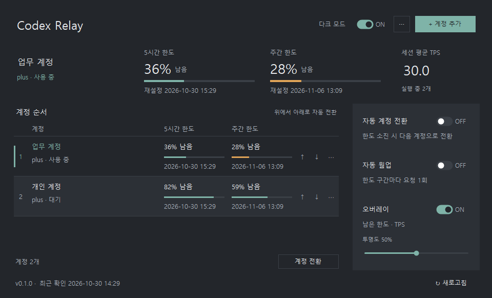

# Codex Relay

[English](README.md) · [한국어](README.ko.md)

A lightweight Windows app for managing Codex accounts and monitoring usage.



Example with demo accounts. The app interface is currently in Korean.

## Features

- Add accounts through login links and set their rotation order
- View 5-hour and weekly limits, and switch to the next available account when a limit is reached
- Warm up each available account once per quota window
- Display remaining quota and session-average TPS in an overlay, with dark mode and adjustable transparency
- Run at Windows sign-in and update the startup path after moving the EXE

## Getting started

Requires Windows 10/11 x64 and .NET Framework 4.8. No installation or administrator privileges are needed.

1. Download `CodexRelay.exe` from [Releases](https://github.com/oiloilo44/codex-relay/releases).
2. Run the EXE. On first launch, it imports the current Codex account if login information is available.
3. Use **계정 추가** (Add account) to sign in to another account. Use **↑ / ↓** to set the rotation order.
4. Enable the options you need. Automatic switching, warm-up, and Windows startup are off by default.

Dark mode is on by default, and your choice is saved. The overlay starts enabled on every launch and initially appears at the bottom right of the screen. Drag it to move it, or double-click it to open the main window. Its position and transparency are saved.

The window's **X** button hides the app to the system tray. To quit, select **⋯ → 종료** (Exit). Use **⋯ → Windows 시작 시 실행** (Run at Windows sign-in) to enable or disable startup. After moving the EXE, quit the running instance and launch it once from the new location.

## How it works

- Automatic switching follows the list order and wraps around. If no account is available, it keeps the current account. Declining an automatic switch turns this option off until you enable it again.
- Manual switching also allows accounts with exhausted or unavailable quota, including accounts you want to use with credits. In this case, automatic switching is turned off to keep your selection. The active account is checked every 10 seconds, or every 5 seconds when 5% or less remains; other accounts are checked every 90 seconds. Network and server delays can affect these timings.
- Accounts with rejected credentials show **재로그인 필요** (Sign-in required). Choose **다시 로그인** (Sign in again) from the account menu to update credentials while keeping its name and list order. These accounts are excluded from automatic checks and switching until reconnected.
- When Codex is running, switching requires confirmation and may interrupt ongoing work. Relay requests the app's normal quit command (`Ctrl+Q`) and waits up to 60 seconds, switching and reopening as soon as exit is confirmed. Force-closing remaining processes after the timeout requires separate confirmation; declining keeps the current authentication. If you customized the quit shortcut, quit Codex manually before switching.
- The quit target is identified by its version-independent Windows package family and window features. If its menu is missing, Relay checks the same window up to four times. A persistently hidden menu requires taskbar identity, native resize/minimize/maximize support, and matching accessibility capabilities. Tool and modal windows are excluded. Changed process/window identity or ambiguous candidates stop switching, and identity is checked again immediately before input.
- A process query failure during shutdown is checked against a retained handle to the same process object. Only confirmed exits are excluded. A live process that remains unreadable still blocks authentication replacement; its PID, query stage, and Windows error code are recorded in the switch log.
- Warm-up sends a model request and consumes a small amount of quota. Quota checks do not send model requests.
- TPS is the average of per-turn TPS values from active local Codex Desktop session logs. Sessions interrupted by an app exit or restart are counted separately and excluded from TPS until resumed. It includes tool execution and waiting time; it is not an instantaneous generation rate. Remote, cloud, and separate CLI sessions are excluded.
- ChatGPT accounts using file-based `auth.json` storage are supported. API-key accounts and keyring storage are not supported.
- This is not an official OpenAI product. Changes to Codex authentication, log formats, or backend endpoints may affect compatibility. The distributed EXE is not code-signed.

## Data storage

Account tokens and settings are stored in `%LOCALAPPDATA%\CodexRelay\vault.bin`, encrypted with Windows DPAPI for the current Windows user. The previous saved copy is kept as `vault.bin.bak`.

The active Codex authentication file defaults to `%USERPROFILE%\.codex\auth.json`, or the directory specified by `CODEX_HOME`. Account switching replaces this file. Do not share authentication files or vault files.

Windows startup uses the `CodexRelay` value under `HKCU\Software\Microsoft\Windows\CurrentVersion\Run` for the current user.

Switch diagnostics are saved under `%LOCALAPPDATA%\CodexRelay\logs`. They record quit input, window state, and process exit checks without account tokens or chat contents. Open the folder from **⋯ → 전환 로그 열기** (Open switch logs).

## Build

Run in PowerShell on Windows. No NuGet packages or separate .NET SDK are required.

```powershell
.\build.ps1
.\bin\CodexRelay.Tests.exe
```

The app is built to `bin\CodexRelay.exe`. Default tests use synthetic data without accessing real accounts. Run `CodexRelay.Tests.exe --render-hidden` for UI checks.

Run `CodexRelay.Tests.exe --window-readonly` to verify selection of the running Codex application window. It only reads window information, without sending input, changing focus, closing processes, or switching accounts.

While visible, the overlay checks its actual window order once per second and restores its position above ordinary application windows when needed, preserving geometry, opacity, and keyboard focus. Hiding the overlay stops this check. Run `CodexRelay.Tests.exe --overlay-window-check` to verify recovery and visibility behavior with briefly displayed synthetic windows, without using real accounts or network requests.

## License

[MIT](LICENSE).
